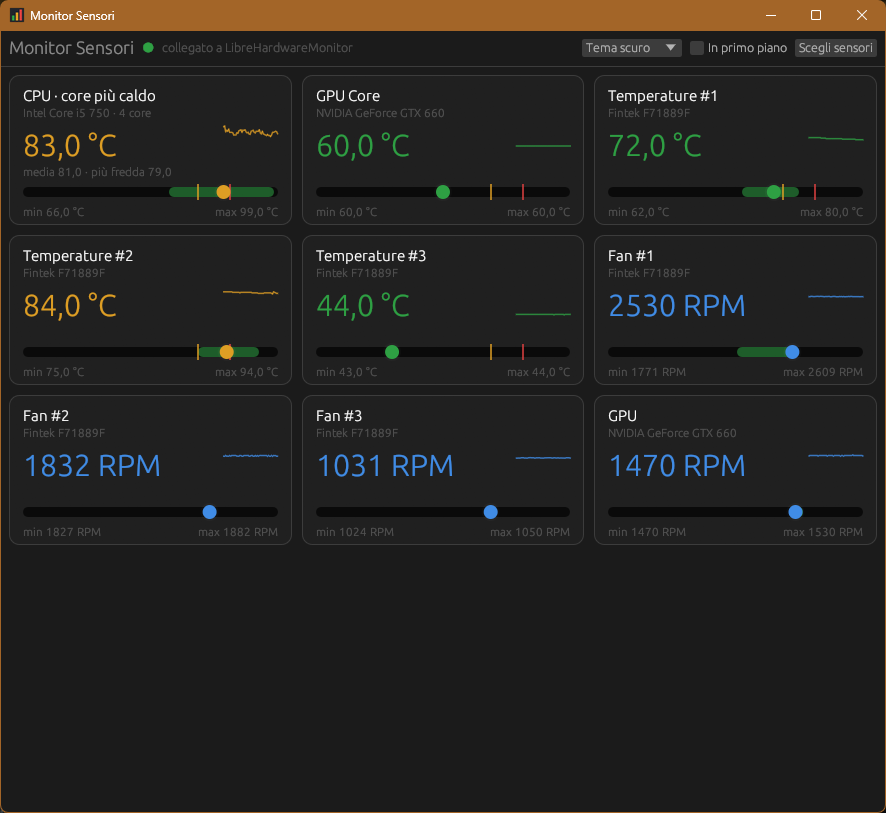

# MonitorRUST

Dashboard per Windows, scritta in Rust, che mostra in grande e a colpo d'occhio i pochi sensori che contano davvero: temperature di CPU e GPU, scheda madre, ventole. **Versione 0.1.0 · 15 ottobre 2026.**



## Come funziona

MonitorRUST **non legge direttamente l'hardware**: è un'interfaccia sopra [LibreHardwareMonitor](https://github.com/LibreHardwareMonitor/LibreHardwareMonitor) (LHM), il programma open source che legge i sensori di CPU, GPU, scheda madre e dischi con il proprio driver.

LHM ha un piccolo web server integrato che pubblica tutti i valori in JSON (`http://localhost:8085/data.json`). MonitorRUST li legge ogni secondo e mostra solo i sensori scelti, in schede grandi e leggibili. Niente driver, niente permessi di amministratore per MonitorRUST: tutto il lavoro sull'hardware resta a LHM.

**Senza LibreHardwareMonitor in esecuzione, MonitorRUST non mostra dati.** MonitorRUST non è affiliato al progetto LibreHardwareMonitor e non ne include il codice.

## Requisiti

- Windows 10/11 x64.
- [LibreHardwareMonitor](https://github.com/LibreHardwareMonitor/LibreHardwareMonitor/releases) (testato con la v0.9.6) con il web server attivo: **Options → Remote Web Server → Run**. LHM ricorda l'impostazione ai riavvii successivi.

Consigliati in LHM: **Start Minimized** e **Minimize To Tray**, così resta nella tray e in primo piano c'è solo la dashboard. Con **Run On Windows Startup** LHM parte all'accensione senza la richiesta di Windows a ogni avvio.

## Avvio

Scarica **MonitorRUST.exe** dalla [release v0.1.0](https://github.com/gmy77/MonitorRUST/releases/tag/v0.1.0) e avvialo con un doppio clic: è un unico eseguibile, non serve installare nulla.

Se LHM non è aperto, MonitorRUST lo avvia da solo (Windows chiede la conferma, perché LHM richiede i permessi di amministratore). Per impostazione predefinita lo cerca nella cartella `LibreHardwareMonitor` accanto a quella di MonitorRUST, ad esempio:

```
Strumenti\
├── LibreHardwareMonitor\LibreHardwareMonitor.exe
└── MonitorRUST\MonitorRUST.exe
```

Il percorso si cambia in **Scegli sensori → Impostazioni**, dove si può anche disattivare l'avvio automatico.

## Funzioni

- **Schede grandi** con il valore colorato: verde, ambra oltre la soglia di attenzione, rosso oltre quella critica (75 °C e 85 °C, modificabili). Una ventola ferma diventa rossa.
- **Barra con fascia verde** tra il minimo e il massimo registrati da LHM, pallino sul valore attuale e tacche delle soglie.
- **Mini grafico** degli ultimi due minuti in ogni scheda.
- **Scheda CPU** con il core più caldo in grande, media e core più freddo; si sceglie quali core considerare.
- **Scelta dei sensori** tra tutti quelli di LHM (temperature, ventole, carico, frequenze, tensioni, dischi), con ordine e nomi personalizzati: ad esempio «Temperature #3» può diventare «Chipset».
- Tema scuro, chiaro o di sistema, finestra sempre in primo piano, schede che si dispongono su più colonne allargando la finestra.
- Le scelte vengono salvate e ritrovate all'avvio successivo.

Alla prima apertura MonitorRUST propone da solo CPU, GPU, temperature della scheda madre e ventole.

## Compilazione da sorgente

Occorrono Windows x64, Rust stabile con target MSVC e i Microsoft C++ Build Tools con Windows SDK (servono anche per incorporare l'icona nell'eseguibile).

```powershell
git clone https://github.com/gmy77/MonitorRUST.git
cd MonitorRUST
cargo build --release
```

Il risultato è `target\release\monitor-rust.exe`. Su PC con raffreddamento modesto, `cargo build --release -j 2` limita la compilazione a due core e scalda meno.

Il progetto usa eframe/egui per la finestra nativa e serde per il JSON; la lettura HTTP di LHM è fatta con la libreria standard, senza client HTTP esterni. L'icona `assets\icon.ico` si rigenera con `python assets\make_icon.py`.

## Struttura

- `src/main.rs`: lettura dei dati di LHM, scelta dei sensori, disegno delle schede e impostazioni.
- `build.rs`: incorpora icona e informazioni di versione nell'exe.
- `assets/`: icona e script che la genera.

## Limiti

- I valori sono quelli di LibreHardwareMonitor: se LHM non riconosce un sensore della scheda madre, o lo legge con una scala sbagliata, MonitorRUST mostra lo stesso dato.
- Minimo e massimo della fascia verde sono quelli di LHM, cioè da quando LHM è stato avviato o da quando li si è azzerati in LHM.
- La dashboard legge soltanto: non regola le ventole e non cambia impostazioni dell'hardware.

## Licenze

Le librerie incluse nell'eseguibile e le loro licenze sono elencate in [THIRD-PARTY-NOTICES.md](THIRD-PARTY-NOTICES.md), con i testi completi in `THIRD-PARTY-LICENSES`.
